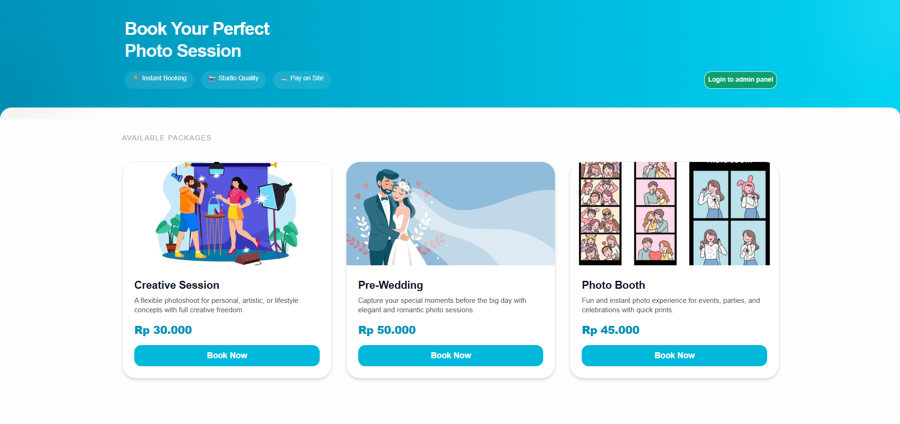

# SelfPhoto Booking

A full-stack booking platform for [a self-photo studio], where customers can book sessions online and admins can manage orders from a dashboard.

🔗 **Live demo:** https://self-photo-booking-one.vercel.app

## Features

- Authentication and role-based access control (RBAC) for **user** and **admin**
- [Browse packages / choose date and time slot]
- [Create and track booking orders with status]
- [Admin dashboard to manage bookings]
- Responsive UI for mobile and desktop

## Tech Stack

- **Frontend:** Next.js (App Router), TypeScript, Tailwind CSS, Flowbite React
- **Backend / Database:** Supabase (PostgreSQL, Auth)
- **Deployment:** Vercel (auto-deploy from GitHub)

## Project Structure

app/         # routes and pages
components/  # reusable UI components
hooks/       # custom React hooks
services/    # API / data access layer
schemas/     # [validation schemas]
types/       # shared TypeScript types
lib/         # utilities and client setup

## Technical Notes

- Designed the relational schema (users, bookings, admin) with draw.io before implementation.
- Managed state with React Hooks (`useState`, `useEffect`) across modular components.
- Implemented RBAC so that [admin-only routes are protected].

## Getting Started

1. Clone the repo
   git clone https://github.com/FaudinCahyoW/SelfPhoto-Booking.git
   cd SelfPhoto-Booking
2. Install dependencies
   npm install
3. Create `.env.local` and add your Supabase keys
   NEXT_PUBLIC_SUPABASE_URL=
   NEXT_PUBLIC_SUPABASE_ANON_KEY=
4. Run the dev server
   npm run dev

## Demo Accounts (optional)

- User: [email] / [password]
- Admin: [email] / [password]
